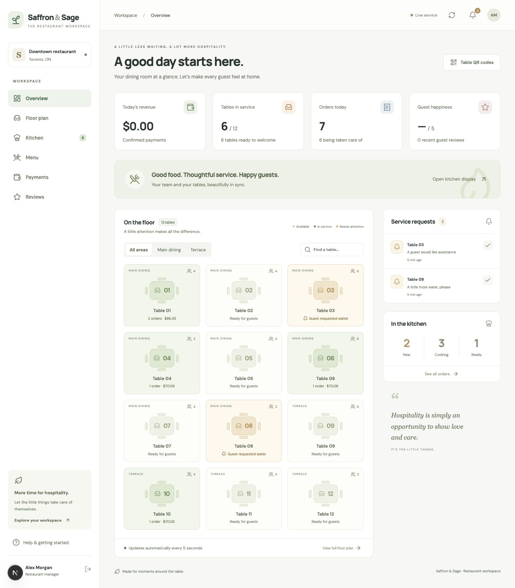

# Saffron & Sage

A restaurant ordering and service application built with **Next.js + TypeScript**, a **Laravel 12 + Sanctum API**, and **MySQL or PostgreSQL**.

The shared demo is designed for testers on different devices: guests place sample orders, staff see them in the kitchen, and table requests and payments use the same shared database.

## Public test login

- **Email:** `demo@saffron.test`
- **Password:** `TrySaffron2026!`

These credentials are intentionally public and belong only to the dedicated sample restaurant. No real orders or payments should be made. Other testers can change the shared sample data.

### Try a complete visit

1. Sign in to the staff workspace.
2. Open **Table QR codes**, choose a table and preview its guest menu, or scan its QR code on another device.
3. In the guest menu, choose a dish and size, add it to the cart and send the order.
4. Return to the kitchen display and move the order through Cooking → Ready → Served.
5. Try a waiter/water request and resolve it from the floor view.
6. From the guest bill, split the balance, select a tip and request a sample cash/bank-transfer payment.
7. Confirm the sample payment in staff Payments, then close the table once every order is served and the bill is settled.

## Features and limits

- Table-specific QR menus, categories, search, allergens, spice levels and sizes.
- Cart, kitchen notes, server-calculated prices/tax and duplicate-submission protection.
- Kitchen workflow, guest status, guest Wi-Fi details, waiter calls and floor view.
- Split bills, tips, manual cash/bank-transfer confirmation, table-closing safeguards and reviews.
- Single restaurant and one staff permission level. Card/Apple Pay/Google Pay processing, refunds, stock control, user administration and accounting integrations are not implemented.
- Table QR codes are bearer capabilities: anyone holding a code can join that table's current visit. For a real restaurant, add seating verification or rotating visit codes if you need stronger access control.

## Run locally

Requirements: Node 22.13+ or Node 24+, npm; PHP 8.2+ with PDO MySQL, mbstring, XML, ctype, curl, intl and zip; Composer; MySQL 8.4+.

```bash
cd backend
composer install
cp .env.example .env
php artisan key:generate
```

Create a MySQL database and app user. Configure the `DB_*` values in `backend/.env`. For a normal installation, set your own `STAFF_EMAIL` and a `STAFF_PASSWORD` of at least 12 characters. Then:

```bash
php artisan migrate --seed
php artisan serve --host=127.0.0.1 --port=8000
```

In another terminal:

```bash
cd frontend
npm ci
npm run dev
```

Open http://localhost:3000. Next.js proxies `/api/*` to Laravel at `http://127.0.0.1:8000`. Set `API_INTERNAL_URL` before building when the backend is elsewhere.

### Enable the shared test configuration

Use a separate sample database, then copy the values from `backend/.env.demo.example` into `backend/.env` and configure its database connection and APP_KEY. Set `NEXT_PUBLIC_SHARED_DEMO=true` for the frontend. This displays the public test credentials and shared-demo notice; authentication still runs through Laravel.

Run `php artisan migrate --seed`, then `php artisan restaurant:demo` to add sample table visits. The demo command requires local mode or `RESTAURANT_DEMO_MODE=true` and does not replace existing orders.

## Checks

```bash
cd backend
php artisan test
cd ../frontend
npm ci
npm run build
NEXT_PUBLIC_SHARED_DEMO=true npm run build
```

Laravel tests use an in-memory SQLite database by default. Do not point RefreshDatabase tests at a real database. The included GitHub Actions template checks backend tests and both frontend build configurations.

## Deployment

The free shared demo is configured for **Render + Supabase PostgreSQL**. See [the Render/Supabase guide](docs/render-supabase.md) for deployment, private connection settings and free-plan limits. The root `render.yaml` defines one free service for Next.js and Laravel.

The alternative [Vercel/Railway deployment guide](docs/deployment.md) remains available for MySQL hosting.

Dockerfiles are included for both applications. [AWS deployment instructions](docs/AWS.md) are also available. Docker image builds and AWS deployment have not been verified on this development machine.

Environment files, databases, generated video/media work and downloaded Instagram footage are excluded from the repository. Infrastructure secrets are not committed. Public demo credentials are deliberately documented.



The GitHub Actions configuration is provided in `deploy/github-actions-ci.yml.example`. To enable CI, copy it to `.github/workflows/ci.yml` using a GitHub login with workflow permission.
